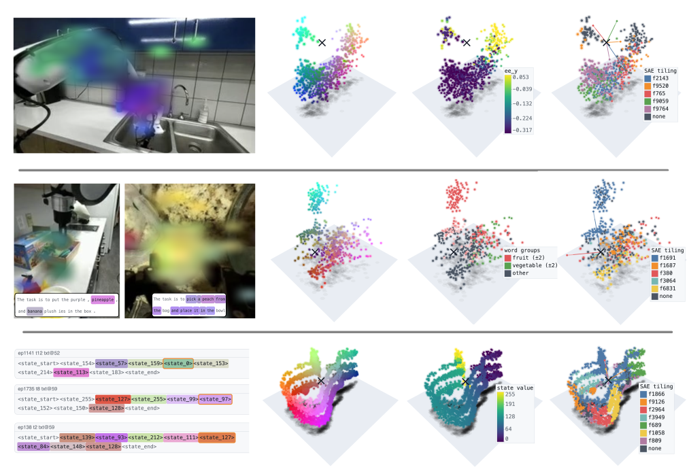

# Multi-Dimensional Featurizers Yield Fine-Grained Steering and Data Shaping in Robot Foundation Models

**Block-sparse featurizers (BSFs) recover multi-dimensional robotics concepts.** Examples from
vision-language-action models encode end-effector position (top), fruit-and-vegetable semantics
(middle), and proprioceptive state (bottom). Each point is a token's 3D feature code, colored by PCA
coordinates, task or semantic labels, and sparse-autoencoder (SAE) assignments across columns. Left
overlays share the PCA colors. SAE features tile distinct regions within each block, showing how BSFs
group related variation into a single feature.

## Code

Code to train BSFs, TopK SAEs (the b = 1 case) and Fisher-weighted BSFs on VLA activations.

## Acknowledgements

`train/bsf.py` is adapted from the Vanilla BSF in
[goodfire-ai/block-sparse-featurizer](https://github.com/goodfire-ai/block-sparse-featurizer).

## License

MIT, see `LICENSE`.
